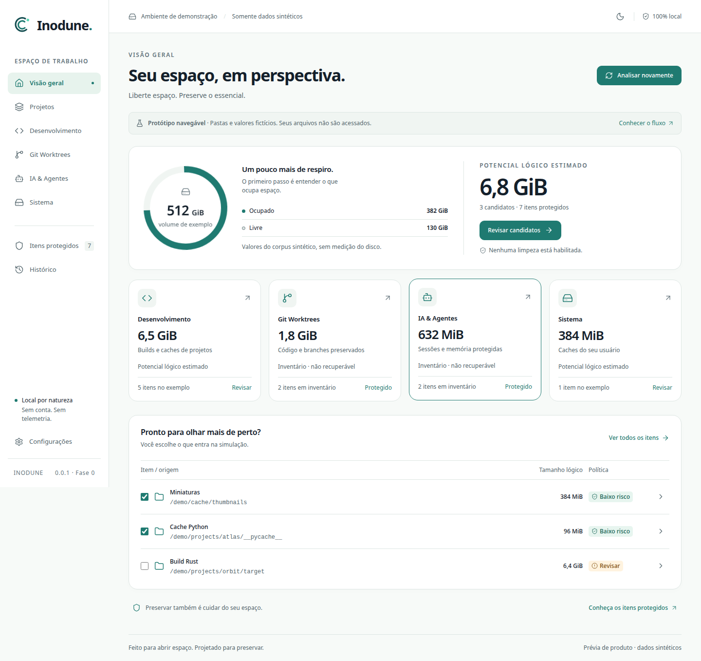

<p align="left"></p>

Liberte espaço. Preserve o essencial.

Aplicativo Linux open source (MIT), com Rust + Tauri 2 + Svelte/TypeScript. **Desktop local com análise e limpeza controlada de caches reconhecidos.** Escolha pastas específicas no diálogo nativo, revise os itens, simule o impacto e confirme o plano no sistema. Fases 0–3 verificadas localmente: providers com h1 e metadados Cargo conhecidos têm revisão individual. Git e formatos incertos permanecem protegidos. Demonstração sintética disponível separadamente.



## Executar o protótipo

Node **24.18.0** e npm (versão usada: 11.16.0). Sem conta, API key, CDN ou telemetria. Rede necessária para instalar dependências; o protótipo funciona localmente depois do build.

```sh
npm ci
npm run dev
# http://127.0.0.1:1420
```

Para verificar o build de produção:

```sh
npm run build
npm run preview -w @inodune/desktop
```

O onboarding é dispensável. Explore análise pausável/cancelável, revisão por item, busca/risco/ordenação, detalhes do detector, Projetos (Project Lens), Itens protegidos (Protection Ledger), simulador de impacto, confirmação e relatório parcial. Configurações permite reproduzir cenário vazio, erro de permissão e itens alterados/falhas. O catálogo mostra componentes e estados. Tema claro/escuro/automático e redução manual de movimento; a preferência do OS também prevalece.

No modo Demonstração, paths `/demo/` são texto de fixture. No desktop local, scan e executor compartilham o core Rust. A interface envia somente IDs de escopos/candidatos e o ID/hash de um plano efêmero; paths não conferem autoridade. Não há API FS/shell/rede genérica. A confirmação final é nativa e a limpeza aceita somente caches de baixo risco reconhecidos. A simulação TypeScript continua restrita à demonstração.

Relatórios e journals locais privados ficam em `XDG_STATE_HOME/inodune/reports`; registram paths, intenções e resultados, sem conteúdos nem uploads. Preferências visuais ficam no armazenamento local. Pastas/seleção de scan ficam na memória da sessão. Arquivos alterados são preservados; resultados parciais e localizações de recuperação aparecem no relatório. Veja [protocolo e limites reais](docs/cleanup-protocol.md).

## Workspace e CLI

```text
crates/inodune-core    descoberta somente leitura, políticas e contratos
crates/inodune-clean   planos efêmeros e executor Linux por descritores
crates/inodune-cli     scan JSON, dry-run padrão, apply confirmado
apps/desktop          Svelte 5 / TypeScript / Vite 8 e shell Tauri 2
assets/brand          assets canônicos fornecidos
tests/fixtures       corpus JSON compartilhado Rust/TS (sem dados pessoais)
docs                  arquitetura, ameaças, UX, checklist e evidências
```

Com Rust **1.93.0** e compilador/linker C instalados:

```sh
cargo run --locked -p inodune-cli -- scan --root /pasta/aprovada --json
cargo run --locked -p inodune-cli -- clean --root /pasta/aprovada --dry-run --json
# Demonstração sem filesystem:
cargo run --locked -p inodune-cli -- scan --demo --json
cargo run --locked -p inodune-cli -- clean --demo --dry-run
```

`scan` é somente leitura e exige roots explícitas. `clean` também é dry-run por padrão; `--apply` é separado e exige digitar `TRASH N` ou `DELETE N` em stdin interativo após revisar paths/hash. `--permanent` escolhe exclusão permanente explicitamente; nunca é fallback da Lixeira. Não usamos esses comandos sobre dados reais nos testes. Exit 2 indica erro/recusa; exit 3 indica resultado parcial. Ctrl+C solicita cancelamento. `attributed_freed_bytes: null` significa ganho **não atribuído**, não zero recuperado. Bytes lógicos processados e variação observada por `statvfs` são distintos. Lixeira no mesmo volume continua ocupando espaço.

## Verificar

```sh
cargo fmt --all --check
cargo clippy --locked --all-targets -- -D warnings
cargo test --locked
npm run typecheck
npm run lint
npm run format:check
npm test
npm run build
npx playwright install chromium webkit
npm run test:e2e
# Só Chromium se WebKit estiver indisponível (isso não aprova o WebKit):
npm run test:e2e -- --project=chromium
```

Os comandos Cargo acima usam `default-members` (core, clean e CLI). **Não incluem o shell desktop.** `cargo check --locked -p inodune-desktop` verifica o shell separadamente. Os testes usam corpus sintético ou árvores temporárias criadas pelo teste, nunca dados ativos. F1 já cobre symlinks, bind mounts em namespace privado, hardlinks, raiz trocada e estados incertos; F2 acrescenta testes do executor para trocas durante captura, escrita concorrente, cancelamento, recuperação e Lixeira, também só em fixtures.

A suíte E2E inicia e encerra seu servidor de produção na porta 1420, que deve estar livre, e grava screenshots em `docs/evidence/`. Veja [resultados e limites da Fase 0](docs/evidence/phase0.md). CI está configurado, mas não foi executado em serviço remoto.

## Desktop Linux e provisionamento

[Tauri 2 exige bibliotecas nativas](https://v2.tauri.app/start/prerequisites/). **Provisionamento nativo já foi autorizado e executado neste Fedora**, sem conceder root ao app. Os comandos abaixo permitem reproduzi-lo em outra instalação autorizada. Instale Rust pelo [rustup oficial](https://rustup.rs/) e o toolchain fixado em `rust-toolchain.toml`.

Ubuntu/Debian (nomes de pacotes devem estar disponíveis na versão da distribuição):

```sh
sudo apt-get update
sudo apt-get install build-essential pkg-config libwebkit2gtk-4.1-dev libgtk-3-dev \
  libssl-dev libxdo-dev libayatana-appindicator3-dev librsvg2-dev libdbus-1-dev
```

Fedora:

```sh
sudo dnf install gcc gcc-c++ make pkgconf-pkg-config webkit2gtk4.1-devel gtk3-devel \
  openssl-devel libxdo-devel libappindicator-gtk3-devel librsvg2-devel dbus-devel
```

Depois:

```sh
npm ci
npm run desktop
```

O app roda com UID comum; `sudo` não é usado no aplicativo. Abertura nativa e jornada WebKitGTK/IPC foram verificadas em Fedora/X11 virtual. Ubuntu e Wayland interativo seguem pendentes. O standalone debug já foi verificado sem Vite; os pacotes ainda estão por implementar. O bundle continua desabilitado; `.deb`/`.rpm` são alvos futuros, sem releases publicados. Não há suporte declarado a Flatpak/AppImage nesta fase.

Neste ambiente Fedora 44, Rust e Zig foram instalados **apenas em `.tools/`**, ignorado pelo Git. GCC também já está instalado. Para repetir os checks com o Rust local desta cópia, use:

```sh
export RUSTUP_HOME="$PWD/.tools/rustup"
export CARGO_HOME="$PWD/.tools/cargo"
export PATH="$CARGO_HOME/bin:$PATH"
cargo test --locked
```

O wrapper alternativo `.tools/cc` chama Zig 0.17.0, mas não é necessário com GCC instalado. Essas ferramentas locais não são dependências distribuídas do produto. Nenhuma configuração global do shell/Git foi alterada.

## Segurança, escopo e pendências

- [Arquitetura](docs/architecture.md), [ameaças](docs/threat-model.md), [política de risco](docs/risk-policy.md) e [checklist](docs/implementation-checklist.md).
- [Jornadas](docs/ux-personas-and-journeys.md), [wireframes](docs/ux-wireframes.md), [design system](docs/design-system.md), [motion](docs/motion-spec.md) e [inovações](docs/innovation-backlog.md).
- Fase 1 implementada: scanner read-only, roots por diálogo nativo, limites/cancelamento, inventário protegido, GUI/CLI compartilhados, Project Lens/Ledger/Explainability e Simulator com metadados de fixtures reais. [Regras e fontes](docs/detectors.md), [evidências](docs/evidence/f1/acceptance.md). Git agora recebe inspeção de estado em sandbox F3 e permanece protegido; locais não documentados também.
- Fase 2: planos backend, executor de folhas de caches, Lixeira, exclusão permanente, journal e relatórios implementados; [verificação da fase](docs/evidence/f2/acceptance.md) registrada. [Protocolo e risco residual do mesmo UID](docs/cleanup-protocol.md). Fase 3 implementada conservadoramente: [regras](docs/f3-detector-policy.md), [evidência](docs/evidence/f3/acceptance.md); remoção/prune Git, módulos e formatos desconhecidos ficam bloqueados por incerteza. Idade não comprova desuso. Estado, sessões/memória e toda incerteza permanecem protegidos.
- Pendentes: Pacotes distribuíveis, testes de usabilidade com participantes, leitor de tela real, zoom 200%, desempenho nativo/60 fps (virtualização e baseline sintético de 10.000 itens já verificados), EN-US, empacotamento e revisão humana antes de release destrutivo. Nenhum desses gates é considerado aprovado.
- Auditoria npm: sem vulnerabilidades de produção na consulta registrada; 14 registros de build/dev (2 low e 12 moderate), principalmente `deepmerge` (prototype poisoning) e `minimatch` (DoS por glob). Sem patch compatível indicado pelo npm; não se considera o tooling livre de vulnerabilidades. Consulte `docs/evidence/npm-audit.json`; não foi usado downgrade automático/forçado.

Os documentos originais `INODUNE_PLAN.md`, `INODUNE_BRAND.md` e `UX_MOTION_INNOVATION.md` seguem normativos. O PNG conceitual não é evidência da implementação. Fonte de sistema sem distribuição de Inter; ícones Lucide sob ISC, dependências com suas próprias licenças. Verificar exclusividade do nome antes de lançamento público.

## Teste do desktop real com fixtures

Somente para desenvolvimento, nunca habilitar a feature de fixtures em pacote distribuído:

```sh
cargo build --locked -p inodune-desktop --features fixture-tests
python3 scripts/native-e2e.py
```

O harness usa Xvfb próprio, XDG isolado, tauri-driver 2.1.0 e WebKitWebDriver correspondente ao sistema. As roots são criadas pelo próprio binário em temporário, sem aceitar path de teste por JS. Os binários de driver nesta cópia estão em `.tools/`; siga o [setup oficial](https://v2.tauri.app/develop/tests/webdriver/manual-setup/) para outra máquina. `scripts/native-smoke.py` é o smoke visual simples. O executável padrão não cria fixtures nem aprova pastas automaticamente.


Limpeza nativa de fixture (build debug isolado; nunca distribuir):

```sh
npm run desktop -- build --debug --no-bundle --features fixture-tests
INODUNE_NATIVE_STANDALONE=1 python3 scripts/native-cleanup-e2e.py
```

Esse harness cria e limpa somente arquivos temporários da própria aplicação e usa consentimento exclusivo da fábrica de fixtures. A feature é proibida em release. Não há bypass de confirmação no binário normal. O smoke CLI equivalente é `python3 scripts/cli-fixture-smoke.py`, também com XDG e dados temporários.

Revisão específica no CLI: `clean --root /pasta/aprovada --review terraform.provider-package --dry-run --json` (ou `cargo.fingerprint-json`). Exige exatamente um item elegível; não implica apply. `--help` e `--version` estão disponíveis. Para repetir a jornada nativa de revisão somente sobre fixtures: `INODUNE_NATIVE_STANDALONE=1 python3 scripts/native-reviewed-e2e.py`, após o build debug com `fixture-tests`.
